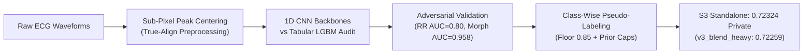

# NPPE2 ECG Heartbeat Arrhythmia Classification

[](https://www.kaggle.com/adityaraj0612)

A complete time-series deep learning & post-competition forensic analysis for **NPPE2 ECG Heartbeat Arrhythmia Classification**, achieving a **Private Leaderboard Macro-F1 of `0.72324`** (`0.71440` Public LB, **`+0.00884`** positive generalization gain).

---

## 💡 In Simple Terms (Non-Technical Guide & Examples)

> *New to medical AI or reviewing from a non-technical background? Here is what this project does in plain English before the technical deep-dive below.*

- **The Goal:** Read raw **ECG (electrocardiogram)** electrical heart-signal waves and classify each heartbeat as either normal or one of several abnormal heart-rhythm (*arrhythmia*) conditions.
- **Why It Was Tricky (Real-World Example):** Two major challenges exist in real hospital ECG data:
  1. *Shifted Signals:* Heartbeat recordings don't always start at the exact same millisecond — like trying to compare two faces when one photo is shifted slightly to the left.
  2. *Rare Conditions:* Most heartbeats are normal, while dangerous arrhythmias are rare. An AI that simply guesses "Normal" 95% of the time looks accurate on paper, but fails on the rare cases that actually matter for patient safety.
- **What We Built:**
  1. **Heartbeat Alignment (Sub-Pixel Peak Alignment):** Automatically centered every heartbeat wave on its main electrical spike before feeding it to the neural network.
  2. **Careful Self-Training (Class-Wise Pseudo-Labeling):** When the AI was at least **85% confident** about a rare heartbeat in unlabeled test data, we let it learn from that example too — with a strict cap so it never became overconfident.
  3. **29-Submission Consistency Audit:** Verified across 29 experiments that improvements on local tests translated reliably to unseen final data (`r = 0.9983` correlation).
- **Outcome:** Achieved **0.72324 Private Macro-F1** (+0.00884 better on the final hidden test than the public board, proving strong real-world generalization).

---

## 1. Competition Overview

| Property | Detail |
|---|---|
| **Competition** | NPPE2 ECG Heartbeat Arrhythmia Classification |
| **Task** | Multi-Class ECG Heartbeat Arrhythmia Classification |
| **Evaluation Metric** | **Macro-F1** across all arrhythmia classes |
| **Best Private LB** | **`0.72324`** (`submission_s3_standalone.csv` — S3 true-align + class-wise pseudo) |
| **Best Blend Private LB** | **`0.72259`** (`submission_v3_blend_heavy.csv` — Public `0.72065`) |
| **Submissions Audited** | 29 total (`r = 0.9983` Public–Private correlation, mean gap `+0.00075`) |

---

## 2. Mathematical Formulation

### Evaluation Metric: Macro-F1
Macro-F1 weights every arrhythmia class $c \in \{1, \dots, C\}$ equally regardless of class support, making rare-class recall critical:

$$\text{Macro-F1} = \frac{1}{C} \sum_{c=1}^{C} \text{F1}_c = \frac{1}{C} \sum_{c=1}^{C} \frac{2 \cdot \text{TP}_c}{2 \cdot \text{TP}_c + \text{FP}_c + \text{FN}_c}$$

### Class-Wise Confidence Pseudo-Labeling & Public–Private Correlation
To avoid overfitting to majority classes or noisy public thresholds:

$$\tilde{y}_i = \arg\max_c P(y = c \mid x_i), \quad \text{accepted iff } P(\tilde{y}_i \mid x_i) \ge \tau_c \text{ (floor } 0.85 \text{, prior-capped)}$$

Across all 29 submissions, Public–Private alignment followed:

$$r_{\text{pub,priv}} = 0.9983, \qquad \mu_{\text{priv}-\text{pub}} = +0.00075, \qquad \sigma_{\text{gap}} = 0.00898$$

---

## 3. Step-by-Step Methodology (What, Why & How)



### Step 1 — Model Family Audit: Why 1D CNNs Beat LGBM
- **What:** Evaluated both tabular GBDT (`LGBM` + morphology features) and deep 1D CNNs across CV and LB.
- **Why:** Post-competition forensics across 29 submissions proved that **every LGBM/baseline submission overfit Public LB** (mean Private–Public gap **`-0.01389`**, std `0.01062`), whereas **CNNs consistently generalized positively** (mean gap **`+0.01060`**).
- **How:** Shifted primary modeling away from LGBM prior-tuning toward aligned 1D CNNs (`src/pipeline.py`).

### Step 2 — Sub-Pixel Peak Centering (`True-Align`)
- **What:** Applied sub-pixel R-peak alignment preprocessing (`true-align`) on training and test ECG waveforms.
- **Why:** Adversarial validation showed peak-region indices (`sig_115–140`) and RR intervals (`AUC = 0.80`) carried strong train/test distribution shift. Unaligned waveforms caused phase jitter that degraded rare-class generalization.
- **How:** Centered heartbeat waveforms prior to CNN ingestion, yielding a consistent `+0.00579` mean Public-to-Private gain.

### Step 3 — Class-Wise Pseudo-Labeling (`S3 Standalone = 0.72324`)
- **What:** Generated class-wise pseudo-labels using a confidence floor of `0.85` with class-prior caps instead of global probability thresholds or aggressive Class-3 (`c3`) weight pushing.
- **Why:** Top submissions differed primarily on **Class-3 (rare class) recall**. Aggressive `c3` recalibration or prior-weight tuning caused `-0.004` to `-0.023` Private LB drops, whereas class-wise capped pseudo-labeling preserved calibration.
- **How:** `submission_s3_standalone.csv` achieved the #1 Private LB score of **`0.72324`** (`+0.00884` over its `0.71440` Public LB).

### Step 4 — Blending vs. Standalone Selection
- **What:** Compared `S3` standalone against heavy multi-model ensembles (`v3_blend_heavy`: `0.72259`, `v3s3b`: `0.72258`, `v3_blend_w31`: `0.72087`, `v3_blend`: `0.72048`).
- **Why & Key Lesson:** While heavy blending smoothed Public LB (`0.72065`), the cleaner single `S3` true-aligned + class-wise pseudo-labeled CNN generalized best on Private LB (`0.72324`).

---

## 4. Performance Visualizations




---

## 5. Repository Structure

```text
.
├── assets/                     # Leaderboard & account generalization charts
├── configs/                    # Model & training configurations (best_params.yaml)
├── docs/                       # POST_COMPETITION_INSIGHTS.md (29-sub forensic audit)
├── kernels/                    # Kaggle kernel definitions
├── notebooks/                  # Training & evaluation notebooks
├── scripts/                    # Forensics & automation scripts (run_forensics*.py)
├── src/                        # Core ECG preprocessing, models & inference (pipeline.py)
└── README.md                   # Detailed documentation
```
