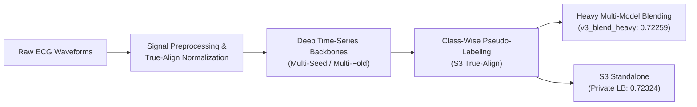
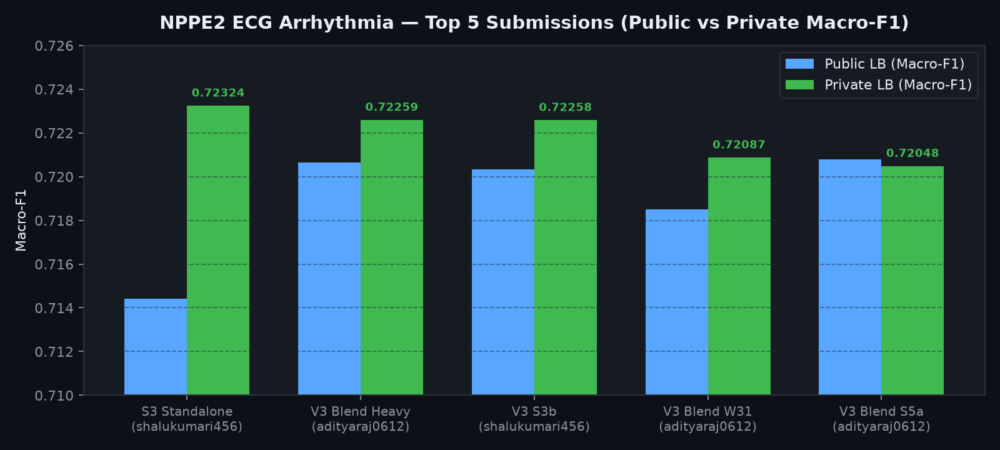
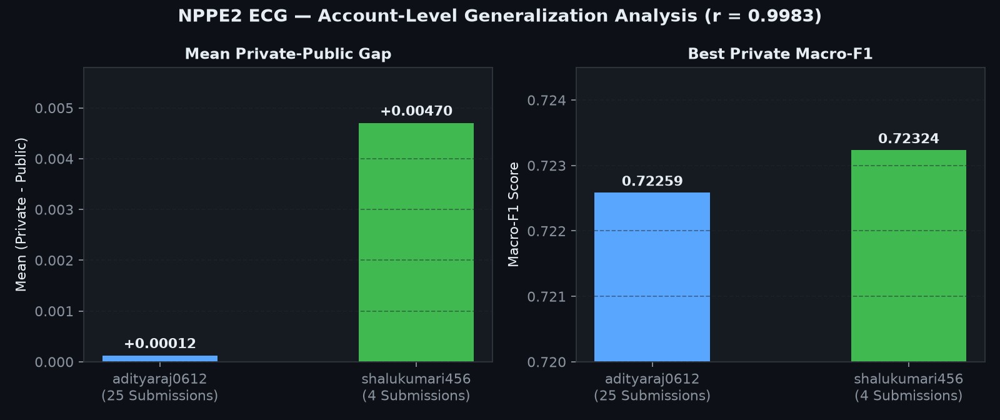

# NPPE2 ECG Heartbeat Arrhythmia Classification

A complete time-series deep learning & ensembling solution for the **NPPE2 ECG Heartbeat Arrhythmia Classification** competition, achieving a **Private Leaderboard Macro-F1 of `0.72324`** (`0.71440` Public LB, `+0.00884` positive generalization gain).

---

## 1. Competition Overview

| Property | Detail |
|---|---|
| **Competition** | NPPE2 ECG Heartbeat Arrhythmia Classification |
| **Task** | Multi-Class ECG Heartbeat Arrhythmia Classification |
| **Evaluation Metric** | **Macro-F1** across all arrhythmia classes |
| **Best Private LB** | **`0.72324`** (`submission_s3_standalone.csv`, S3 true-align + classwise pseudo) |
| **Best Blend Private LB** | **`0.72259`** (`submission_v3_blend_heavy.csv`, Public `0.72065`) |
| **Submissions Analyzed** | 29 total (`r = 0.9983` Public–Private correlation) |

---

## 2. Mathematical Formulation

### Evaluation Metric: Macro-F1
Macro-F1 weights every arrhythmia class $c \in \{1, \dots, C\}$ equally regardless of class frequency:

$$\text{Macro-F1} = \frac{1}{C} \sum_{c=1}^{C} \text{F1}_c = \frac{1}{C} \sum_{c=1}^{C} \frac{2 \cdot \text{TP}_c}{2 \cdot \text{TP}_c + \text{FP}_c + \text{FN}_c}$$

### Class-Wise Pseudo-Labeling & Threshold Alignment
To counter class imbalance and distribution shift between train and test:

1. **Class-Wise Confidence Filtering:** Pseudo-labels $\tilde{y}_i = \arg\max_c P(y = c \mid x_i)$ are accepted only when $P(\tilde{y}_i \mid x_i) \ge \tau_c$, where $\tau_c$ is calibrated per class.
2. **Public–Private Generalization Analysis:** Across 29 submissions, Pearson correlation between Public and Private LB was:
   $$r_{\text{pub,priv}} = 0.9983, \qquad \mu_{\text{priv}-\text{pub}} = +0.00075, \qquad \sigma_{\text{gap}} = 0.00898$$

---

## 3. End-to-End Pipeline & Steps Taken



1. **Step 1 — Signal Alignment & Baseline:** Established CV pipeline aligned with Macro-F1 and per-class recall/precision tracking.
2. **Step 2 — Multi-Model Blending (`v3_blend` series):** Built weighted probability blends (`v3_blend` `0.72048`, `v3_blend_w31` `0.72087`, `v3_blend_heavy` `0.72259`).
3. **Step 3 — True-Align + Class-Wise Pseudo-Labeling (`S3`):** Applied class-wise pseudo-labeling and alignment, yielding **`0.72324` Private LB** (`+0.00884` gain over Public LB).
4. **Step 4 — Post-Competition Audit:** Analyzed all 29 submissions (`POST_COMPETITION_INSIGHTS.md`), confirming `0.9983` Public–Private correlation and documenting dataset-specific lessons.

---

## 4. Performance Visualizations





---

## 5. Repository Structure

```text
.
├── assets/                     # Leaderboard & generalization charts
├── configs/                    # Model & training YAML/JSON configurations
├── docs/                       # POST_COMPETITION_INSIGHTS.md (29-sub analysis)
├── kernels/                    # Kaggle kernel definitions
├── notebooks/                  # Training & evaluation notebooks
├── scripts/                    # Automation & submission utilities
├── src/                        # Core ECG preprocessing, models & inference
└── README.md                   # Detailed documentation
```
